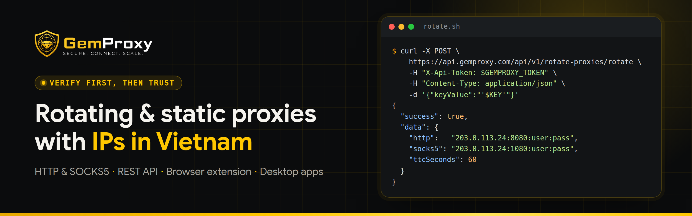

<div align="center">

<a href="https://gemproxy.com?utm_source=github&utm_medium=bio&utm_campaign=github-profile">
  <picture>
    <source media="(prefers-color-scheme: dark)" srcset="assets/banner-dark.png">
    <source media="(prefers-color-scheme: light)" srcset="assets/banner-light.png">
    
  </picture>
</a>

<br>

[](https://gemproxy.com?utm_source=github&utm_medium=bio&utm_campaign=github-profile) [](https://gemproxy.com/pricing?utm_source=github&utm_medium=bio&utm_campaign=github-profile) [](https://app.gemproxy.com/api-docs) [](https://chromewebstore.google.com/detail/ofbgenpeacgpiinhegahahfkjlddbgli) [](https://addons.mozilla.org/addon/gemproxy/) [](https://t.me/gemproxy_support_bot) [](https://buymeacoffee.com/gemproxyofc)

</div>

## About GemProxy

**GemProxy** ([gemproxy.com](https://gemproxy.com?utm_source=github&utm_medium=bio&utm_campaign=github-profile)) sells proxies with IP addresses in Vietnam. Rotating proxies change IP when you call the API or press a button in the dashboard. Static proxies keep the same residential or datacenter IP for the whole rental. You buy, top up and manage everything in one dashboard, and you can check a proxy's exit IP and speed there before you put it to work.

## What we offer

<table>
  <tr>
    <td width="33%" valign="top">
      <br>
      <h3>Rotating proxies</h3>
      <ul>
        <li>IPv4 addresses in Vietnam</li>
        <li>HTTP and SOCKS5</li>
        <li>New IP on request, after a 1 to 5 minute wait depending on the plan</li>
        <li>Hourly and daily plans</li>
      </ul>
      <a href="https://gemproxy.com/rotating-proxy?utm_source=github&utm_medium=bio&utm_campaign=github-profile"><b>Rotating plans →</b></a>
    </td>
    <td width="33%" valign="top">
      <br>
      <h3>Static proxies</h3>
      <ul>
        <li>Residential IPs in Vietnam, carrier of your choice (Viettel, VNPT or FPT, depending on the plan)</li>
        <li>Datacenter IPs in Vietnam and the US</li>
        <li>One IP for the whole rental, unlimited bandwidth</li>
      </ul>
      <a href="https://gemproxy.com/static-proxy?utm_source=github&utm_medium=bio&utm_campaign=github-profile"><b>Static plans →</b></a>
    </td>
    <td width="33%" valign="top">
      <br>
      <h3>Developer API</h3>
      <ul>
        <li>REST API, one <code>X-Api-Token</code> header</li>
        <li>Rotate keys, buy and renew proxies from your own code</li>
        <li>Try-it console and samples in cURL, Node.js, Python, Go, PHP, Ruby, Java and C#</li>
      </ul>
      <a href="https://app.gemproxy.com/api-docs"><b>API docs →</b></a> <sub>(sign-in required)</sub>
    </td>
  </tr>
</table>

## Verify first, then trust

1. **Start small.** The hourly rotating plan is the cheapest way to try the network.
2. **Check it yourself.** Open **Proxy Checker** in the dashboard and look at the exit IP and speed.
3. **Scale when it fits.** Buy more, or a longer period, once the results match your work.

## Rotate an IP from code

```bash
curl -X POST https://api.gemproxy.com/api/v1/rotate-proxies/rotate \
  -H "X-Api-Token: $GEMPROXY_TOKEN" \
  -H "Content-Type: application/json" \
  -d '{"keyValue":"YOUR_KEY"}'
```

The response carries the new proxy as `host:port:user:pass` for HTTP and SOCKS5, plus `ttcSeconds`, the wait before the next rotation. Calling again too early returns `PROXY_ROTATE_COOLDOWN_NOT_REACHED`. Create a token under **API Keys** in the [API docs](https://app.gemproxy.com/api-docs#keys).

## Apps

| Where | Get it |
|---|---|
| Browser extension (Chrome, Edge, Firefox) | [Chrome Web Store](https://chromewebstore.google.com/detail/ofbgenpeacgpiinhegahahfkjlddbgli) · [Firefox Add-ons](https://addons.mozilla.org/addon/gemproxy/) |
| Desktop app (Windows, macOS, Linux) | [gemproxy.com/download](https://gemproxy.com/download?utm_source=github&utm_medium=bio&utm_campaign=github-profile) |
| Telegram Mini App | [@gemproxy_app_bot](https://t.me/gemproxy_app_bot) |

Payments: VND wallet topped up by VietQR bank transfer, or USDT on TRC20, BEP20, Polygon and Arbitrum One.

## Work with us

- **Affiliate:** earn a share of what the customers you refer spend. [Affiliate program](https://gemproxy.com/affiliate?utm_source=github&utm_medium=bio&utm_campaign=github-profile)
- **Resellers:** run your own proxy store on your own domain. [Reseller program](https://gemproxy.com/reseller?utm_source=github&utm_medium=bio&utm_campaign=github-profile)
- **Business:** [sales@gemproxy.com](mailto:sales@gemproxy.com)

## Support our free guides

Our blog posts and videos on how proxies work, how to check one and how to set it up are free. If one of them saved you time, you can buy us a coffee.

<a href="https://buymeacoffee.com/gemproxyofc"></a>

## Contact

[Telegram support](https://t.me/gemproxy_support_bot) · [support@gemproxy.com](mailto:support@gemproxy.com) · [Facebook](https://www.facebook.com/GemProxyOfficial/) · [YouTube](https://www.youtube.com/@gemproxyofficial) · [Blog](https://gemproxy.com/blog?utm_source=github&utm_medium=bio&utm_campaign=github-profile)

---

### Tiếng Việt

**GemProxy** bán proxy có IP tại Việt Nam: proxy xoay đổi IP qua API hoặc một nút bấm trên dashboard, và proxy tĩnh giữ nguyên một IP dân cư hoặc datacenter suốt kỳ thuê. Mua gói, nạp tiền bằng VietQR hoặc USDT, rồi tự kiểm tra IP và tốc độ ở mục Kiểm tra proxy trước khi dùng thật.

[Trang chủ](https://gemproxy.com?utm_source=github&utm_medium=bio&utm_campaign=github-profile) · [Bảng giá](https://gemproxy.com/pricing?utm_source=github&utm_medium=bio&utm_campaign=github-profile) · [Tải ứng dụng](https://gemproxy.com/download?utm_source=github&utm_medium=bio&utm_campaign=github-profile) · [Hỗ trợ qua Telegram](https://t.me/gemproxy_support_bot) · [Mời tụi mình ly cà phê](https://buymeacoffee.com/gemproxyofc)

<br>

<p align="center"><sub>GemProxy · Kiểm chứng trước, tin sau.</sub></p>
